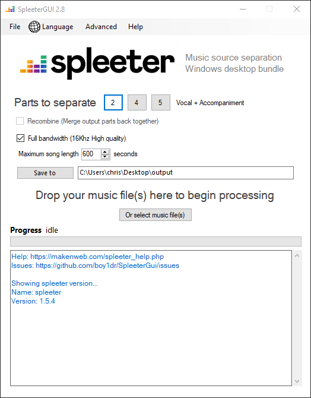

## SpleeterGUI - Music source separation desktop app  
Windows Desktop Front end for Spleeter - AI source separation  
   
Latest package can be downloaded from here <A href="https://spleetergui.com">https://spleetergui.com</a>
No need to install python or spleeter, this app contains a portable version of python pre-loaded with spleeter.  
Older versions here https://makenweb.com/#spleetergui  
The aim for this project is to make it easy for Windows users to download and run Spleeter without needing to use the command line tools to do so.  

  

This project is a simple C# desktop front end for Spleeter.  
Please consider donating and help pay for hosting and development paypal.me/makenitso  

## Version history  
27/07/2020 - MS Defender is falsely identifying V2.7 as a trojan. The exe has been submitted to Microsoft and given the all clear.  
             Defender definition version 1.319.2309.0 finds no threat
	     More details can be found here https://github.com/boy1dr/SpleeterGui/issues/36

| Date | Version | Notes |
| ----: |:-------:| ----- |
| 24/11/2026 | 2.9.6 | Unofficial maintenance update (GUI only, same python/spleeter core). Output format choice (wav/mp3/flac/ogg/m4a/wma), Cancel and Open folder buttons, add songs while a batch is running, clear error messages when a song fails, sharper on high-DPI screens, many bug fixes. See below. |
| 7/10/2023 | 2.9.5 | Rebuilt with python 3.10.10 and spleeter 2.4. Updated GUI. New website spleetergui.com |
| 5/04/2022 | 2.9.2 | Upgraded spleeter to 2.3.0.   Updated python files, the spleeter core update feature is working again. |
| 30/01/2021 | 2.9.1 | Upgraded spleeter to 2.1.2.   Updated command syntax for latest Spleeter version. |
| 9/11/2020 | 2.9 | Upgraded spleeter to 2.0.1 and python.  |
| 31/07/2020 | 2.8 | Upgraded the project to 64bit. |
| 19/07/2020 | 2.7 | Updated help, set paths for python/ffmpeg (use your own python) |
| 4/07/2020 | 2.6 | Recombine audio and multi-lingual update. |
| 10/05/2020 | 2.5 | UI update, Additional help menu items for version check and spleeter core upgrade, Display installed spleeter version on startup |
| 4/05/2020 | 2.4 | Bug fix: "full bandwidth" mode checked but not enabled by default. |
| 27/12/2019 | 2.3 | Accessibility update (process button, tab order, access labels and descriptions, ding on complete etc.) |
| 24/12/2019 | 2.2 | New windows MSI installer. Drag and drop processing. |
| 21/12/2019 | 2.0 | Interface update, added Batch processing. |
| 17/12/2019 | 1.1 | Added High quality/expert mode. |
  

## What changed in 2.9.6
- The Spleeter core is found next to the exe, in `%APPDATA%\SpleeterGUI` (older installers) or wherever Advanced > Set SpleeterGUI path points; a missing core is reported instead of failing silently.
- Works with both generations of the Spleeter command line (2.0.x and 2.1 - 2.4), also when the installed version cannot be read.
- The bundled python no longer picks up packages of another python installed for the same user (the cause of errors such as `cannot import name 'get_terminal_size' from 'click.termui'`).
- A song that fails no longer stalls the queue. The log says which song failed, explains the common causes in plain words (incomplete model download, out of memory, no internet, missing ffmpeg), and only reports "Saved" for files that were really written by that run.
- A model folder left incomplete by an interrupted download is downloaded again by itself (it used to fail on every run until the folder was deleted by hand).
- Songs with the same name in one batch (`CD1\01 Intro.mp3`, `CD2\01 Intro.mp3`) no longer overwrite each other.
- Output format can be chosen, and Recombine works with every format and overwrites an older recombined file.
- Folders can be dropped, songs can be added while a batch runs, and a batch can be cancelled. Closing the window stops the running job instead of leaving python behind.
- File names with non-English characters and output folders ending in `\` work.
- Settings and the generated config are written to the user profile, so the app works when installed under Program Files. Settings are carried over to the next version, and a damaged settings file is reset instead of blocking startup.
- The window scales with the Windows display scale and long translations no longer overlap or get cut off. A missing or incomplete language file falls back to English.
- The update check no longer freezes or crashes the app when offline.

## Command line
```
SpleeterGui.exe [-o <output folder>] <song or folder> [<song or folder> ...]
```
Opens the window and starts separating the given songs right away. Folders are searched for music files. `-o` is used for this run only; without it the last used output folder is taken.

## Building from source
Needs the [.NET SDK](https://dotnet.microsoft.com/download) (6 or newer) or Visual Studio 2019+. The app still targets .NET Framework 4.8, which ships with Windows 10 and 11.
```
cd SpleeterGui
dotnet build -c Release
```
The result is in `SpleeterGui\bin\Release`. To run it, either copy the `python` folder, `ffmpeg.exe`, `ffprobe.exe` and `pretrained_models` from an installed SpleeterGUI next to the exe, or point Advanced > Set SpleeterGUI path at the folder of an installed SpleeterGUI.

## Older versions  
Version 2.8 https://makenweb.com/downloads/SpleeterGUI_V2.8.msi  
Version 2.7 https://makenweb.com/downloads/SpleeterGUI_V2.7.msi  

## Examples
https://www.youtube.com/watch?v=bdNzVPLzOLE  
https://www.youtube.com/watch?v=nxJfIsus0Ig  
https://www.youtube.com/watch?v=PHGAmZhuI-c  
https://www.youtube.com/watch?v=3X5nfc2d1Rw  
https://www.youtube.com/watch?v=9KkWJHC2bz0  
https://www.youtube.com/watch?v=Mygm1sFlQXc  

The project contains the C# source code for the Graphical User Interface. It also contains Python3.7 and the Spleeter project.  

Feel free to inspect the source code and build for yourself. you can also install your own python/tensorflow/ffmpeg/spleeter.
